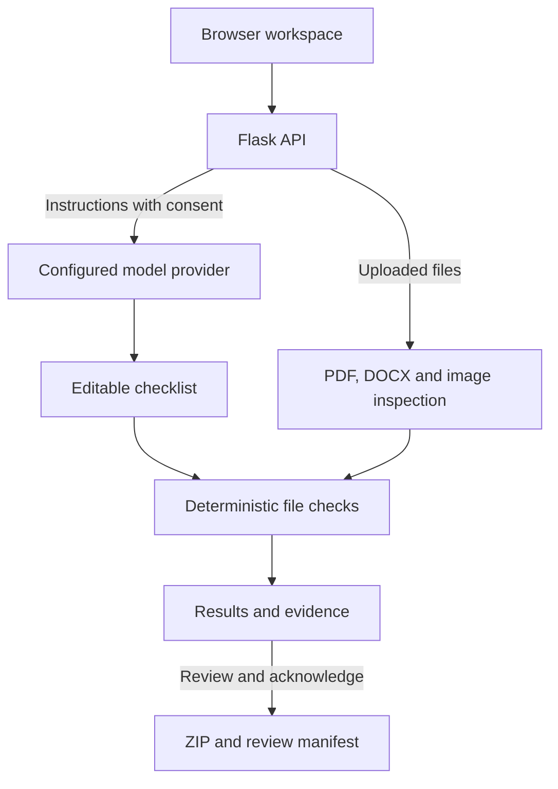

<div align="center">


<p>
  
  
  
  
  
</p>

<p>
  
  
  
  
</p>

**You did the hard part. Let’s wrap it up.**

An AI-assisted workspace that turns assignment instructions into editable checklists, checks your files, and packages your completed work into an organized ZIP.

[The problem](#the-problem) · [Features](#key-features) · [Architecture](#architecture) · [Setup](#setup-from-scratch) · [Demo](#try-the-demo-workflow) · [Limitations](#limitations)

</div>

## The problem

The assignment is finished. The submission still isn't.

The instructions are buried in a message. The report has an extra page. A screenshot is missing. Files have confusing names, and the final ZIP needs to follow a particular structure. These small details turn a completed assignment into a last-minute scramble.

**SubmitSloth helps with the repetitive preparation between “work completed” and “ready to submit.”**

## Who it's for

- **Students** preparing reports, source code and screenshots for submission.
- **Project teams** bringing multiple members’ deliverables into one package.
- **Hackathon participants** checking a set of deliverables before sharing their work.

## The solution

Paste or import the assignment brief, generate an AI-assisted checklist, and review the extracted requirements. Upload your completed files, confirm their roles, and run structural checks. Then preview filenames and folders before downloading the ZIP.

Every result is labeled **Passed**, **Needs a fix**, or **Needs review**, with an explanation of what was checked.

> SubmitSloth helps prepare a submission. It does not write the assignment, grade its quality, or submit it to a university portal.

**Built for:** Hacktoberfest Open-Source AI Challenge — Week 3  
**Theme:** Slow and Steady  
**Focus:** Student productivity · Open-weight AI · Repetitive task automation

## Key features

- **AI-assisted requirement extraction** — turns natural-language instructions into a structured checklist using a configurable OpenAI-compatible model provider.
- **Editable requirements** — change descriptions, check types, target file groups and comparison values before running checks.
- **Evidence-based checks** — inspect PDF page counts, file presence, minimum file counts, literal text and original filenames.
- **Honest uncertainty** — ambiguous criteria stay in **Needs review** instead of receiving a misleading green tick.
- **Instruction import** — read text PDFs, DOCX and UTF-8 text; extract text from images when server-side Tesseract is available.
- **Drag-and-drop uploads** — group files as reports, code, screenshots or supporting material, with editable output paths.
- **Organized ZIP export** — preserve original file contents and include a machine-readable review manifest.
- **Interactive interface** — midnight-blue styling, an animated SVG sloth, smooth transitions, responsive layouts and reduced-motion support.
- **Manual mode** — build and use checklists without an AI key. The sample checklist is explicitly hand-written.
- **Server-side secrets** — API credentials stay in environment variables, outside frontend code.

## Demo

## Demo

Try **SubmitSloth** online:

👉 **[Launch SubmitSloth](https://submitsloth.onrender.com)**

Turn assignment instructions into an editable checklist, check your files,
and download an organized submission ZIP.

> Hosted on Render. If the service is waking up, the first visit may take
> a little longer to load.

### Try the demo workflow

1. Click **Try a sample** to load a sample brief and hand-written checklist. This action does not call an AI model.
2. Upload the individual files from `examples/before/`.
3. Run checks: the report has **3 pages against a 2-page limit**, and there are **2 screenshots against a requirement of 3**.
4. Replace the report with `examples/fixed/report.pdf` and add `examples/fixed/screenshot_03.png`.
5. Run checks again. The corrected structural requirements pass; human judgment requirements remain for review.
6. Preview the ZIP, acknowledge any unresolved items, download it and inspect its contents.

For an AI demonstration, paste `examples/instructions.txt` and use **Build with AI** with a working provider configuration instead of the hand-written sample.

> All bundled reports and images are synthetic demo fixtures. They are not real student submissions or evidence of model performance.

## Architecture



### Technical stack

| Layer | Technology |
|---|---|
| Frontend | HTML, CSS, vanilla JavaScript, inline SVG |
| Backend | Python, Flask |
| AI integration | OpenAI-compatible chat-completions API; Groq-specific request settings |
| Example hosted model configuration | `openai/gpt-oss-120b` through Groq |
| Native PDF inspection | pypdf |
| DOCX text extraction | Python ZIP and XML libraries |
| Image inspection | Pillow |
| Optional image OCR | Tesseract, installed in the supplied Docker image |
| Packaging | Python `zipfile` |
| Production HTTP server | Waitress |
| Tests | Python `unittest` and Flask test client |
| Storage | No database or persistent project history |

Frontend and backend are served together. No Node installation or separate frontend build is required for normal use.

## How the checks work

| Check | What it verifies | Important boundary |
|---|---|---|
| File exists | A readable file is assigned to the selected role | Does not prove the content or format meets the brief |
| Maximum pages | Each selected readable PDF is within the limit | DOCX pagination requires manual review or PDF conversion |
| Minimum file count | Enough readable files are present in the selected group | Screenshot content is not semantically verified |
| Contains exact text | A case-insensitive literal match in extracted text | Missing text needs review; extraction can miss content |
| Original filename equals | The uploaded basename matches the specified name | Does not check a proposed export filename |
| Human review | Preserves a criterion for a person to assess | Never automatically marked as passed |

AI interprets the brief; deterministic code performs supported structural checks. The model does not decide the check results. An AI requirement with a missing or nonmatching source quote is downgraded to human review. A matching quote still needs the user's review for correct interpretation.

## Why open innovation matters

SubmitSloth uses a configurable model interface instead of tying its workflow to one provider. An open-weight model can interpret the brief through a hosted API or a separately configured local server.

- **Model flexibility:** change the provider or model through environment variables.
- **Local deployment option:** run file processing on your own machine and connect to a locally served model.
- **Inspectable behavior:** review the extraction prompt, validation rules and checks in the source code.
- **Independent checks:** file inspection and packaging continue to work in explicit manual mode when inference is unavailable.

Local inference requires a separately downloaded model and sufficient hardware. Hosted inference is not automatically free or offline. Manual mode alone is not an AI-centered hackathon demonstration.

## Project structure

```text
app.py                     Flask routes, instruction import and ZIP export
serve.py                   Waitress entry point
requirements.txt           Python dependencies
Dockerfile                 App image with English Tesseract OCR
.env.example               Configuration template
static/
  index.html               Four-stage workspace
  styles.css               Responsive theme and animations
  app.js                   Editing, uploads, checks and downloads
submitsloth/
  core.py                  File inspection and deterministic checks
  ai.py                    Model requests and response validation
tests/
  test_workflow.py          Structural checks and export tests
  test_ai_errors.py         Provider diagnostics and payload tests
examples/
  instructions.txt         Example assignment brief
  before/                  Inputs with deliberate submission issues
  fixed/                   Corrected report and missing screenshot
DEMO.md                    Demo plan and evaluation guidance
LICENSE                    MIT license
```

## Setup from scratch

### Prerequisites

- Python **3.11 or 3.12**.
- A browser.
- A provider key and available open-weight model for hosted AI extraction, or a separately configured local inference server.
- Optional Tesseract installation for local image OCR. Docker includes it on the server.

### Windows PowerShell

Open PowerShell in the directory containing `app.py`:

```powershell
py -m venv .venv
.\.venv\Scripts\python.exe -m pip install -r requirements.txt
Copy-Item .env.example .env
.\.venv\Scripts\python.exe app.py
```

Open **http://127.0.0.1:5000**. These commands use the environment's Python directly, so activation is unnecessary. Copy `.env.example` only on first setup; keep your existing `.env` when updating the code.

### macOS / Linux

```bash
python3 -m venv .venv
.venv/bin/python -m pip install -r requirements.txt
cp .env.example .env
.venv/bin/python app.py
```

### Environment variables

Example Groq configuration:

```dotenv
AI_BASE_URL=https://api.groq.com/openai/v1
AI_MODEL=openai/gpt-oss-120b
AI_API_KEY=your_groq_api_key_here
HOST=127.0.0.1
PORT=5000
```

Set a model available to your provider account. The API base URL must stop before `/chat/completions`; the application appends that path. Restart the server after changing configuration. Never commit `.env` or paste a real key into a public issue.

For an already-installed model served locally through Ollama:

```dotenv
AI_BASE_URL=http://localhost:11434/v1
AI_MODEL=your_installed_model_tag
AI_API_KEY=
```

Leave `AI_BASE_URL` and `AI_MODEL` empty for manual-only mode. Missing configuration or provider errors are shown explicitly; they do not silently produce a fake AI checklist.

## Docker deployment

```bash
docker build -t submitsloth .
docker run --rm -p 5000:5000 --env-file .env submitsloth
```

The Dockerfile installs English Tesseract, runs as a non-root user and starts the app with Waitress. `serve.py` binds to all interfaces and reads the `PORT` environment variable.

For a Docker Web Service on Render:

- Connect the repository containing the Dockerfile.
- Set the service root to the directory containing `app.py` and `Dockerfile`.
- Add `AI_BASE_URL`, `AI_MODEL` and `AI_API_KEY` as hosting environment variables.
- Use `/api/status` as the health-check path.
- Use the Dockerfile's default command.
- Test AI extraction, upload, inspection and ZIP download on the deployed URL.

The application is hosted on Render:
[Open SubmitSloth](https://submitsloth.onrender.com).

## Privacy and file handling

- Instruction text goes to the configured AI provider only after the consent checkbox is selected.
- Assignment file contents are not sent to the model by this implementation.
- Uploaded files are processed by the app's server. On hosted deployments, that means the hosting server—not solely the browser.
- There is no saved project history. Refreshing the browser clears the in-memory workspace.
- Request handling may use framework-managed temporary files; image OCR uses a temporary directory cleaned up after processing.
- Source code uploads are never executed.
- Export changes filenames and folder structure while preserving file contents.
- Unsafe or duplicate ZIP paths are rejected.
- Failed checks, manual review items and file warnings require acknowledgment before export.

## Testing and verification

Run from the directory containing `app.py`:

```powershell
.\.venv\Scripts\python.exe -m unittest discover -s tests -v
```

The suite contains **19 tests** across the workflow and AI-diagnostics modules. Provider responses are mocked in the AI tests; those tests do not establish real-model extraction accuracy.

| Verification | Recorded result |
|---|---|
| Original workflow suite | 16 tests passed during initial development |
| Updated AI diagnostics | 3 mocked regression tests passed |
| Bundled before/fixed inputs | Expected structural failures and corrections verified |
| ZIP preservation | Exported report bytes matched the input |
| JavaScript syntax | Checked during initial development |
| Basic Groq connectivity | A separate local test returned HTTP 200 |
| End-to-end live AI extraction | Not yet confirmed in the recorded verification |
| Public deployment | Hosted on Render; live link available above |
| End-to-end hosted workflow | Manually tested: AI checklist → file checks → ZIP download |

The full 19-test suite was not rerun successfully together after the diagnostics update because Flask was unavailable in that test environment. Install the requirements and run the suite in your environment before release. A successful greeting request is connectivity evidence, not proof that the full checklist workflow works.

## Troubleshooting AI requests

| Result | What to inspect |
|---|---|
| HTTP 400 | Model settings, request parameters and instruction length |
| HTTP 401 | API key and server restart after changing it |
| HTTP 403 | Provider/project permissions or network-gateway rejection |
| HTTP 404 | API base URL and exact model identifier |
| HTTP 429 | Provider rate limits or quota |
| Network / TLS error | Connectivity, proxy settings and certificate configuration |
| Invalid checklist | Model response format and supported requirement values |

If the independent diagnostic succeeds but the app fails, compare their environment and request headers. The diagnostic used `User-Agent: SubmitSloth/1.1`; include that header alongside `Content-Type` in `submitsloth/ai.py` when applying the documented compatibility update. Keep the Authorization header. Do not disable certificate verification or expose API keys in logs.

## Limitations

- **No automatic grading:** quality, correctness, formatting and ambiguous criteria require human judgment.
- **No automatic portal submission:** the user downloads and submits the package.
- **No automatic content repair:** renaming does not convert formats, shorten reports or correct coursework.
- **No general scanned-PDF OCR:** paste extracted instructions or provide an image for optional OCR.
- **No recursive ZIP inspection:** upload individual source files for checks.
- **No semantic screenshot validation:** roles are user-confirmed and counts are structural.
- **Bounded inspection:** up to 60 files, 12 MB per file and a 30 MB total HTTP request; image and document extraction limits also apply.
- **Limited text extraction:** PDF text checks inspect up to the first 100 pages and 200,000 characters.
- **No authentication or rate limiting:** add access controls and quotas before exposing a paid inference endpoint broadly.
- **No measured AI accuracy or time-saving claim:** evaluate representative briefs and record real results before publishing benchmarks.

## Future improvements

- Complete live-model and hosted workflow verification.
- Add authentication, per-user quotas and rate limiting.
- Evaluate extraction against manually annotated assignment briefs.
- Add explicit file-format and export-name validation.
- Extend OCR to scanned PDFs with bounded resource usage.
- Add optional saved workspaces with clear retention controls.

## Author and license

Built by **[Imran Ghafoor](https://github.com/Imran-Ghafoor594)**.

Application code is licensed under the **[MIT License](LICENSE)**. Dependencies and configured AI models retain their own licenses and terms.

<div align="center">

**Do the work. Skip the scramble.**


</div>
